# 🏆 GitHub Achievements — Complete Guide

A complete reference to **GitHub Profile Achievements**: what they are, how tiers work, official badge logos, visual graphs, and step-by-step instructions to unlock every earnable badge.

---

## 📖 Table of Contents

- [What Are GitHub Achievements?](#-what-are-github-achievements)
- [GitHub Achievements Ecosystem Graph](#-github-achievements-ecosystem-graph)
- [All Earnable Achievements (Logos & Tiers)](#-all-earnable-achievements-logos--tiers)
- [Step-by-Step Guide to Unlock Every Achievement](#-step-by-step-guide-to-unlock-every-achievement)
- [Achievement Tiers Explained](#-achievement-tiers-explained)
- [Badge Skin Tone Customization](#-badge-skin-tone-customization)
- [Retired (No Longer Earnable) Achievements](#-retired-no-longer-earnable-achievements)
- [Unreleased / Experimental & Staff Badges](#-unreleased--experimental--staff-badges)
- [Achievements vs. Profile Highlights](#-achievements-vs-profile-highlights)
- [Settings, Privacy & Troubleshooting](#-settings-privacy--troubleshooting)
- [Fair Play & Rules](#-fair-play--rules)

---

## 🤔 What Are GitHub Achievements?

**GitHub Achievements** are visual badges displayed in the left sidebar of your GitHub profile (under the **Achievements** section). They recognize milestones, open-source collaboration, community help, and sponsorships across GitHub.

- **Where they appear:** On your public profile sidebar (click any badge to view its tier, unlock date, and qualifying contributions).
- **Tiers:** Some achievements are one-time unlocks, while others level up across **4 tiers** (*Default*, *Bronze*, *Silver*, and *Gold*), shown as `x2`, `x3`, and `x4` tags on the badge.
- **Private activity:** Contributions in private repositories can still unlock badges if you allow private contributions on your profile, while keeping exact repository details hidden from unauthorized viewers.

---

## 🗺️ GitHub Achievements Ecosystem Graph

> *GitHub natively renders Mermaid diagrams directly in `README.md` files.*

```mermaid
flowchart TD
    A["🏆 GitHub Profile Badges"] --> B["✅ Earnable Achievements"]
    A --> C["🕰️ Retired Achievements"]
    A --> D["🧪 Unreleased / Staff"]
    A --> E["✨ Profile Highlights (Separate Section)"]

    B --> B1["🦈 Pull Shark<br/>Merged PRs: 2 / 16 / 128 / 1024"]
    B --> B2["⭐ Starstruck<br/>Repo Stars: 16 / 128 / 512 / 4096"]
    B --> B3["👥 Pair Extraordinaire<br/>Co-authored PRs: 1 / 10 / 24 / 48"]
    B --> B4["🧠 Galaxy Brain<br/>Accepted Answers: 2 / 8 / 16 / 32"]
    B --> B5["⚡ Quickdraw<br/>Close Issue/PR < 5 mins (1x)"]
    B --> B6["🚀 YOLO<br/>Merge PR without review (1x)"]
    B --> B7["💖 Public Sponsor<br/>Sponsor via GitHub Sponsors (1x)"]

    C --> C1["❄️ Arctic Code Vault Contributor (2020)"]
    C --> C2["🚁 Mars 2020 Helicopter Contributor (2021)"]

    D --> D1["❤️ Heart On Your Sleeve (Experimental)"]
    D --> D2["🧙 Open Sourcerer (Experimental)"]
    D --> D3["🛡️ GitHub Staff (Internal Only)"]

    E --> E1["PRO · Developer Program · Bug Bounty · Campus Expert"]
```



---

## 🏅 All Earnable Achievements (Logos & Tiers)

There are **7 active achievements** that any developer can earn today:

| Logo | Achievement Name | How to Earn | Default (1x) | Bronze (`x2`) | Silver (`x3`) | Gold (`x4`) |
| :---: | :--- | :--- | :---: | :---: | :---: | :---: |
|  | **Pull Shark** | Open Pull Requests that get merged | 2 | 16 | 128 | 1,024 |
|  | **Starstruck** | Own a personal repository that earns stars | 16 | 128 | 512 | 4,096 |
|  | **Pair Extraordinaire** | Co-author commits in a merged Pull Request | 1 | 10 | 24 | 48 |
|  | **Galaxy Brain** | Have your reply marked as the accepted answer in repository Discussions | 2 | 8 | 16 | 32 |
|  | **Quickdraw** | Close an Issue or Pull Request within 5 minutes of opening it | 1 | — | — | — |
|  | **YOLO** | Merge a Pull Request without a code review | 1 | — | — | — |
|  | **Public Sponsor** | Sponsor an open-source developer or project via GitHub Sponsors | 1 | — | — | — |

> **Note:** GitHub does not publish official numeric tier thresholds in its documentation; the numbers above are verified by the developer community.

---

## 🛠️ Step-by-Step Guide to Unlock Every Achievement

### 1. ⚡ Quickdraw
**Goal:** Close an Issue or Pull Request within 5 minutes of opening it.

1. Go to any repository you own (or create a test repository).
2. Click the **Issues** tab → **New issue**.
3. Enter a title (e.g., `Setup initial checklist`) and click **Submit new issue**.
4. Within **5 minutes**, click **Close issue** at the bottom.
5. Refresh your GitHub profile—**Quickdraw** will unlock!

---

### 2. 🦈 Pull Shark
**Goal:** Get Pull Requests merged (works on open-source repos or your own repos).

1. Fork or open a repository and create a new branch:
   ```bash
   git checkout -b fix/update-docs
   ```
2. Make a meaningful change, stage it, and commit:
   ```bash
   git add .
   git commit -m "docs: improve README instructions"
   git push origin fix/update-docs
   ```
3. On GitHub, go to the **Pull requests** tab → **New pull request**.
4. Compare your branch against `main` and click **Create pull request**.
5. Once the PR is **Merged**, it counts toward Pull Shark:
   - **2 merged PRs** → Default
   - **16 merged PRs** → Bronze (`x2`)
   - **128 merged PRs** → Silver (`x3`)
   - **1,024 merged PRs** → Gold (`x4`)

---

### 3. 🚀 YOLO
**Goal:** Merge a Pull Request **without** a code review.

1. In a repository where you have merge permissions (such as your own repo), create a new branch (or edit a file directly on GitHub and select *"Create a new branch for this commit and start a pull request"*).
2. Open the Pull Request.
3. Do **not** wait for or add an approving review.
4. Click **Merge pull request** → **Confirm merge** immediately.
5. **YOLO** unlocks automatically (1 tier only).

---

### 4. 👥 Pair Extraordinaire
**Goal:** Co-author a commit in a Pull Request that gets merged.

1. Collaborate with a teammate or contributor on a branch.
2. When committing, leave **two blank lines** after your commit title and add the exact `Co-authored-by:` trailer using your collaborator's GitHub name and the email linked to their GitHub account:
   ```bash
   git commit -m "feat: add authentication middleware


   Co-authored-by: CollaboratorName <collaborator-email@example.com>"
   ```
   *(Tip: If you edit/commit via GitHub Desktop or the GitHub web UI, you can also add the `Co-authored-by:` line directly in the extended commit description box.)*
3. Push the branch and open a Pull Request.
4. Merge the Pull Request. Both you and the co-author receive credit toward **Pair Extraordinaire**!
   - **1 / 10 / 24 / 48** co-authored merged PRs for Default / Bronze / Silver / Gold.

---

### 5. 🧠 Galaxy Brain
**Goal:** Have your answers accepted in **GitHub Discussions**.

1. Find a repository that has **Discussions** enabled (under the repo's **Discussions** tab).
   *(Note: Answers in the global GitHub Community Discussions no longer count; it must be a repository's Discussions.)*
2. Look for open questions in the **Q&A** category.
3. Post a helpful, accurate reply.
4. Once the discussion author or a maintainer clicks **Mark as answer**, it counts toward **Galaxy Brain**.
   - **2 / 8 / 16 / 32** accepted answers for Default / Bronze / Silver / Gold.

---

### 6. ⭐ Starstruck
**Goal:** Own a personal repository that reaches star milestones.

1. Build and publish a useful project, tool, template, or resource under your **personal GitHub account** (repositories owned by an Organization do **not** count).
2. Write a clean `README.md` with screenshots/GIFs, clear setup steps, and relevant repository topics/tags.
3. Share your project genuinely with developer communities (e.g., Reddit, Dev.to, Hacker News, X/Twitter, Discord).
4. Reach **16 stars** on a single repository to unlock Default (and **128 / 512 / 4,096** for Bronze / Silver / Gold).

---

### 7. 💖 Public Sponsor
**Goal:** Financially support an open-source maintainer or project via GitHub Sponsors.

1. Find a developer or open-source project with a **Sponsor** button on their profile or repository (or browse [github.com/sponsors](https://github.com/sponsors)).
2. Click **Sponsor** and choose a one-time or monthly tier (even $1 works).
3. Ensure your sponsorship visibility is set to **Public** (not Private) during checkout.
4. Complete the payment—**Public Sponsor** will appear on your profile.

---

## 📊 Achievement Tiers Explained

Multi-tier achievements (`Pull Shark`, `Starstruck`, `Pair Extraordinaire`, `Galaxy Brain`) upgrade visually with a badge multiplier pill in the corner:

| Tier | Badge Label | Color Accent |
| :--- | :---: | :--- |
| **Tier 1 (Default)** | *(No label)* | Standard badge artwork |
| **Tier 2 (Bronze)** | `x2` | Bronze (`#F9BFA7`) |
| **Tier 3 (Silver)** | `x3` | Silver (`#E1E4E4`) |
| **Tier 4 (Gold)** | `x4` | Gold (`#FAE57E`) |

---

## 🎨 Badge Skin Tone Customization

Two achievements—**Starstruck** and **Quickdraw**—feature hands and automatically adapt to your **Emoji skin tone preference**:

1. Click your profile picture (top-right) → **Settings**.
2. Select **Appearance** in the left sidebar.
3. Scroll down to **Emoji skin tone preference**.
4. Choose your preferred tone (`Default`, `Light`, `Medium-Light`, `Medium`, `Medium-Dark`, `Dark`).
5. Your Starstruck and Quickdraw badges will update to match.

---

## 🕰️ Retired (No Longer Earnable) Achievements

These badges were awarded for historical one-time events. Users who earned them keep them on their profiles, but new users cannot unlock them:

| Logo | Name | Why It Was Awarded |
| :---: | :--- | :--- |
|  | **Arctic Code Vault Contributor** | Contributed code to active public repositories captured in the **February 2, 2020** GitHub Archive Program snapshot stored in Svalbard, Norway. |
|  | **Mars 2020 Helicopter Contributor** | Contributed to open-source repositories used in NASA's **Mars 2020 Ingenuity** helicopter mission. |

---

## 🧪 Unreleased / Experimental & Staff Badges

You may occasionally see these badges referenced in GitHub's asset repository or on internal accounts:

| Logo | Name | Status |
| :---: | :--- | :--- |
|  | **Heart On Your Sleeve** | **Unreleased / Experimental** — Observed in GitHub experiments; not publicly earnable. |
|  | **Open Sourcerer** | **Unreleased / Experimental** — Observed in GitHub experiments; not publicly earnable. |
| — | **GitHub Staff** | **Staff Only** — Exclusively shown for GitHub employees. |

---

## ✨ Achievements vs. Profile Highlights

People often confuse **Highlights** with **Achievements**. Highlights appear directly under your bio (above Achievements) and represent account programs or statuses rather than activity milestones:

| Highlight Badge | How You Get It |
| :--- | :--- |
| **PRO** | Active paid **GitHub Pro** subscription. |
| **Developer Program Member** | Registered member of the **GitHub Developer Program**. |
| **Security Bug Bounty Hunter** | Submitted a valid vulnerability report to the **GitHub Security Bug Bounty** program. |
| **GitHub Campus Expert** | Student leader trained through the **GitHub Campus Experts** program. |

---

## ⚙️ Settings, Privacy & Troubleshooting

### How to Show or Hide Achievements
Achievements are **enabled by default**. To toggle visibility:
1. Click your profile picture → **Settings**.
2. Go to **Public profile**.
3. Scroll to **Profile settings / Contributions & activity**.
4. Check or uncheck **Show Achievements on my profile**.
5. Click **Update preferences**.

### Include Private Contributions
If you want PRs or issues in **private repositories** to count toward your achievements:
1. Go to **Settings → Public profile**.
2. Enable **Include private contributions on my profile**.
*(Others will see the badge, while links to private repositories remain hidden.)*

### Why Isn't My Badge Showing Up?
- **Caching / Queue Delay:** GitHub processes some achievement updates asynchronously; wait a few hours and refresh.
- **First Achievement in Private Repo:** If your very first badge was earned in a private repo, your profile's `?tab=achievements` section may take time to initialize until a public event or batch sync occurs.
- **Wrong Email on `Co-authored-by`:** For *Pair Extraordinaire*, the co-author's email must match a verified email on their GitHub account.
- **Org Repo for Starstruck:** Only repositories owned directly by your personal user account count for *Starstruck*, not organization repos.
- **GitHub Community Discussions:** *Galaxy Brain* requires accepted answers in standard **repository Discussions**, not GitHub Community discussions.

---

## 📜 Fair Play & Rules

GitHub's **Acceptable Use Policies** prohibit inauthentic activity such as buying/exchanging stars, using bot accounts, or spamming Pull Requests solely to farm badges. Violating these rules can result in badge removal or account suspension. Focus on genuine learning, open-source contributions, and real collaboration!
